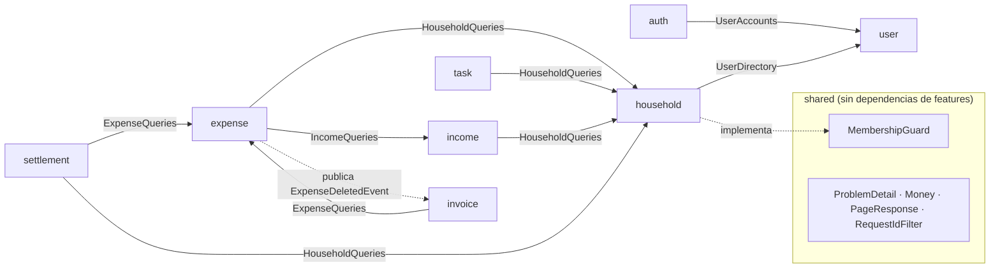

# Hogar API

> Nombre provisional. Proyecto de portfolio de backend Java.

API REST para parejas y compañeros de piso: ingresos, gastos comunes con **reparto configurable**
(a partes iguales o proporcional a ingresos), facturas adjuntas, tareas de casa con rotación y
liquidaciones ("quién debe a quién"). **La app no mueve dinero real**: solo registra y calcula.

**Estado:** fases 0–8 terminadas (setup, auth, finanzas, tareas, facturas, balances, pulido, plan
freemium y cliente). `./mvnw verify` en verde con **687 tests unitarios + 726 de integración** contra
PostgreSQL real. Plan y resultado de cada fase en [`docs/PLAN.md`](docs/PLAN.md); 69 decisiones
registradas en [`docs/DECISIONS.md`](docs/DECISIONS.md). Cliente Flutter (Android, iOS y web) en
[Sechuam/hogar-app](https://github.com/Sechuam/hogar-app).

| | |
|---|---|
| Lenguaje | Java 21 (records, `switch` expressions, pattern matching de `instanceof`) |
| Framework | Spring Boot 3.5: Web, Data JPA, Security + OAuth2 Resource Server, Validation, Actuator |
| Datos | PostgreSQL 17, migraciones Flyway (`ddl-auto=validate`) |
| Auth | JWT propio HS256 (Nimbus) + refresh token opaco rotatorio; login con Google (ID token + JWKS) |
| Docs API | springdoc-openapi (Swagger UI) |
| Tests | JUnit 5, AssertJ, Mockito, Testcontainers, ArchUnit, JaCoCo |
| Infra | Docker (multi-stage, JRE, usuario no root), Docker Compose, GitHub Actions |
| Observabilidad | Actuator + Prometheus en puerto de gestión, logs JSON (ECS), `X-Request-Id` |

## Índice

- [Arranque rápido](#arranque-rápido)
- [Arquitectura](#arquitectura)
- [Modelo de datos](#modelo-de-datos)
- [Funcionalidad y endpoints](#funcionalidad-y-endpoints)
- [Decisiones de diseño destacadas](#decisiones-de-diseño-destacadas)
- [Calidad y tests](#calidad-y-tests)
- [Seguridad](#seguridad)
- [Deuda conocida y siguientes pasos](#deuda-conocida-y-siguientes-pasos)

## Arranque rápido

Requisitos: Docker (y JDK 21 para ejecutar fuera de contenedores o lanzar los tests).

**Todo en contenedores** (API + PostgreSQL):

```bash
cp .env.example .env      # rellena DB_PASSWORD y JWT_SECRET (openssl rand -base64 48)
docker compose up --build
```

**En local** (solo la BD en Docker; logs legibles con el perfil `dev`):

```bash
docker compose up -d db
./mvnw spring-boot:run    # lee el mismo .env (spring.config.import)
```

| URL | Qué es |
|---|---|
| http://localhost:8080/api | API REST |
| http://localhost:8080/swagger-ui.html | Swagger UI (OpenAPI completo, con esquema bearer y errores) |
| http://localhost:8080/v3/api-docs | Documento OpenAPI en JSON |
| http://localhost:8080/livez · `/readyz` | Probes de liveness y readiness (públicas; las usa el healthcheck de Compose) |
| http://localhost:8081/actuator | Actuator: `health`, `info`, `metrics`, `prometheus`. Puerto de gestión: accesible en local, **no publicado** por Compose (solo dentro de su red) |

La colección [`http/`](http/README.md) recorre el flujo completo (registro → hogar → gastos →
factura → tareas → liquidaciones) con el cliente HTTP de IntelliJ o VS Code.

### Variables de entorno

Todas en [`.env.example`](.env.example); `.env` no se versiona. Ningún secreto tiene valor por defecto.

| Variable | Uso |
|---|---|
| `DB_PASSWORD` | Contraseña de PostgreSQL (**obligatoria**) |
| `JWT_SECRET` | Secreto HMAC de los JWT, Base64 de ≥ 32 bytes (**obligatoria**: la app no arranca sin él) |
| `DB_NAME`, `DB_USERNAME`, `DB_URL`, `DB_PORT` | Conexión a la BD (`DB_URL` solo en local; Compose apunta al servicio `db`) |
| `SERVER_PORT` | Puerto de la API (8080) |
| `MANAGEMENT_PORT` | Puerto de Actuator (8081) |
| `SPRING_PROFILES_ACTIVE` | Perfil en local: `dev` = logs legibles |
| `DOCKER_SPRING_PROFILES` | Perfil dentro de Compose (`docker` por defecto): logs JSON ECS |
| `GOOGLE_CLIENT_IDS` | Client IDs de Google aceptados como `aud` (vacío = login con Google desactivado en la práctica) |
| `STORAGE_DIR` | Directorio de las facturas (en Compose, volumen `invoices`) |
| `CORS_ALLOWED_ORIGINS` | Orígenes de navegador permitidos, separados por comas (vacío = sin CORS; p. ej. `http://localhost:5000` para el cliente Flutter web) |

## Arquitectura

**Monolito modular por features** ([D-002](docs/DECISIONS.md#d-002--monolito-modular-por-feature-con-capas-internas--aceptada-fase-0)):
cada feature es un paquete con sus capas `controller → service → repository / domain` y sus `dto`.
Un monolito es lo proporcionado al tamaño del problema; los límites entre features son explícitos
y están preparados para extraerse si hiciera falta.

```
com.hogar
├── shared/      error (ProblemDetail), money, security, validation, web (paginación, request id), config
├── user/  auth/  household/  income/  expense/  invoice/  task/  settlement/
│     └── controller/ service/ repository/ domain/ dto/
```

Reglas **verificadas en cada build por ArchUnit** (`ArchitectureTest`), no solo documentadas:

- Los controllers no usan repositorios ni entidades: reciben y devuelven DTOs (`record`), con mapeo manual.
- Una feature solo depende de otra a través de su `service` (interfaces públicas) y sus `dto`; además
  de los enums de dominio, que son lenguaje compartido ([D-035](docs/DECISIONS.md#d-035--los-enums-de-dominio-son-lenguaje-publicado-entre-features--aceptada-fase-2)).
- `shared` no depende de ninguna feature. Las entidades viven en `domain`.
- Entre agregados, referencias por UUID, no asociaciones JPA cruzadas ([D-017](docs/DECISIONS.md#d-017--agregados-referenciados-por-uuid-también-dentro-de-una-feature--aceptada-fase-1)).

Dependencias permitidas entre features (flecha = "usa"; etiqueta = contrato):



Todas las features usan `shared`; `MembershipGuard` es el contrato con el que cualquier endpoint
bajo `/api/households/{id}/**` comprueba la membresía, y lo implementa `household`. El borrado de un
gasto avisa a `invoice` con un evento síncrono: `expense` no conoce a `invoice`
([D-055](docs/DECISIONS.md#d-055--consistencia-bd--disco-antes-un-huérfano-que-una-fila-sin-fichero--aceptada-fase-4)).

Convenciones transversales: dinero siempre `BigDecimal` escala 2 y `NUMERIC(19,2)` (nunca `double`);
IDs UUID generados en la aplicación; `Instant` UTC y `LocalDate` para fechas de negocio con un `Clock`
inyectado (tests deterministas); `@Transactional` solo en servicios; `open-in-view=false`; `@Version`
en los agregados editables; errores como `ProblemDetail` (RFC 9457) con `code` estable y `requestId`
([D-004](docs/DECISIONS.md#d-004--formato-de-errores-problemdetail-con-code-estable--aceptada-fase-0)).

## Modelo de datos

Esquema creado por las migraciones Flyway `V1`–`V11`
([`src/main/resources/db/migration`](src/main/resources/db/migration)); Hibernate solo lo valida.

```mermaid
erDiagram
    users ||--o{ user_identities : "se vincula con"
    users ||--o{ refresh_tokens : "abre sesiones"
    users ||--o{ memberships : "pertenece"
    households ||--o{ memberships : "tiene"
    households ||--o{ invitations : "emite"
    households ||--o{ incomes : "registra"
    users ||--o{ incomes : "percibe"
    households ||--o{ shared_expenses : "registra"
    users ||--o{ shared_expenses : "paga"
    shared_expenses ||--|{ expense_shares : "se reparte en"
    users ||--o{ expense_shares : "debe"
    shared_expenses ||--o| invoices : "adjunta"
    households ||--o{ tasks : "organiza"
    users |o--o{ tasks : "asignado a"
    tasks ||--o{ task_rotation_members : "rota entre"
    tasks ||--o{ task_completions : "historial"
    households ||--o{ settlements : "anota"
    users ||--o{ settlements : "paga o recibe"

    users {
        uuid id PK
        varchar email UK "minúsculas (CHECK)"
        varchar display_name
        varchar password_hash "NULL si solo Google"
        boolean email_verified
        bigint version
    }
    user_identities {
        uuid id PK
        uuid user_id FK
        varchar provider "GOOGLE"
        varchar subject "UK con provider"
    }
    refresh_tokens {
        uuid id PK
        uuid user_id FK
        uuid family_id "rotación y revocación"
        char token_hash UK "SHA-256"
        timestamptz expires_at
        timestamptz revoked_at
        uuid replaced_by_id
    }
    households {
        uuid id PK
        varchar name
        varchar split_policy "EQUAL o PROPORTIONAL"
        varchar plan "FREE o PREMIUM"
        char currency "ISO-4217"
        bigint version
    }
    memberships {
        uuid id PK
        uuid household_id FK
        uuid user_id FK
        varchar role "OWNER o MEMBER"
        timestamptz joined_at
        timestamptz left_at "baja lógica"
        uuid removed_by FK "quién expulsó"
    }
    invitations {
        uuid id PK
        uuid household_id FK
        varchar code UK
        uuid created_by FK
        timestamptz expires_at
        int max_uses
        int uses "CHECK uses <= max_uses"
        timestamptz revoked_at
    }
    incomes {
        uuid id PK
        uuid household_id FK
        uuid user_id FK
        numeric amount "19,2"
        date start_date
        boolean recurring
        date end_date
        bigint version
    }
    shared_expenses {
        uuid id PK
        uuid household_id FK
        uuid paid_by FK
        uuid created_by FK
        numeric amount "19,2"
        char currency
        varchar category
        date expense_date
        varchar split_policy_applied "snapshot"
        boolean split_fallback
        bigint version
    }
    expense_shares {
        uuid id PK
        uuid expense_id FK "ON DELETE CASCADE"
        uuid user_id FK
        numeric amount "suma = importe del gasto"
        numeric weight "ingreso usado o 1"
    }
    invoices {
        uuid id PK
        uuid household_id FK
        uuid expense_id FK "UK, FK compuesta con household_id"
        varchar storage_key UK
        varchar content_type "por magic bytes"
        bigint size_bytes
        char sha256
        varchar filename
        uuid uploaded_by FK
    }
    tasks {
        uuid id PK
        uuid household_id FK
        varchar title
        uuid assignee_id FK
        varchar recurrence "NONE DAILY WEEKLY MONTHLY"
        date due_date
        date anchor_date
        varchar status "PENDING o DONE"
        uuid created_by FK
        bigint version
    }
    task_rotation_members {
        uuid task_id PK, FK
        int position PK
        uuid user_id FK "UK con task_id"
    }
    task_completions {
        uuid id PK
        uuid task_id FK
        uuid completed_by FK
        uuid assignee_id FK
        date due_date
        timestamptz completed_at
    }
    settlements {
        uuid id PK
        uuid household_id FK
        uuid from_user_id FK
        uuid to_user_id FK "CHECK distinto de from"
        numeric amount "19,2"
        char currency
        date settlement_date
        uuid created_by FK
    }
```



Claves del diseño: las membresías no se borran (`left_at`) y un índice único parcial garantiza una sola
activa por usuario y hogar ([D-016](docs/DECISIONS.md#d-016--membresías-con-baja-lógica-left_at--aceptada-fase-1));
las invariantes críticas se duplican como `CHECK`/`UNIQUE` en BD
([D-018](docs/DECISIONS.md#d-018--invariantes-críticas-duplicadas-en-bd--aceptada-fase-1)); una factura no puede
apuntar a un gasto de otro hogar gracias a una FK compuesta
([D-056](docs/DECISIONS.md#d-056--factura-y-gasto-del-mismo-hogar-garantizado-por-bd--aceptada-fase-4)); no hay
tabla de balances: se calculan.

## Funcionalidad y endpoints

Todos los endpoints salvo `/api/auth/**` y las probes exigen `Authorization: Bearer <access token>`.
Bajo `/api/households/{id}/**` hay que ser miembro activo. Referencia completa (cuerpos, ejemplos y
cada `code` de error) en **Swagger UI**; los contratos de cada fase están en [`docs/api/`](docs/api).

| Área | Endpoints principales | Contrato |
|---|---|---|
| Autenticación | `POST /api/auth/register` · `login` · `google` · `refresh` · `logout`; `GET /api/users/me` | [Fase 1](docs/api/fase-1-contratos.md) |
| Hogares y miembros | `POST/GET /api/households`, `GET/PATCH /api/households/{id}`, `GET …/plan`, `GET …/members`, `PATCH/DELETE …/members/{userId}`, `POST …/leave` | [Fase 1](docs/api/fase-1-contratos.md) |
| Invitaciones | `POST/GET …/invitations`, `GET/DELETE …/invitations/{invitationId}`, `POST /api/invitations/{code}/accept` | [Fase 1](docs/api/fase-1-contratos.md) |
| Ingresos | `POST/GET …/incomes`, `GET/PUT/DELETE …/incomes/{incomeId}`, `GET …/incomes/summary?month=` | [Fase 2](docs/api/fase-2-contratos.md) |
| Gastos y reparto | `POST/GET …/expenses` (filtros `from`, `to`, `category`, `paidBy`), `GET/PUT/DELETE …/expenses/{expenseId}` | [Fase 2](docs/api/fase-2-contratos.md) |
| Tareas | `POST/GET …/tasks` (filtros `mine`, `assigneeId`, `status`, `overdue`), `GET/PUT/DELETE …/tasks/{taskId}`, `POST …/complete`, `POST …/reopen`, `GET …/completions` | [Fase 3](docs/api/fase-3-contratos.md) |
| Facturas | `POST/GET/DELETE …/expenses/{expenseId}/invoice` (multipart / descarga), `GET …/invoice/metadata` | [Fase 4](docs/api/fase-4-contratos.md) |
| Balances y liquidaciones | `GET …/balances`, `GET …/settlements/suggested`, `POST/GET …/settlements`, `GET/DELETE …/settlements/{settlementId}` | [Fase 5](docs/api/fase-5-contratos.md) |

**Plan FREE / PREMIUM** ([D-068](docs/DECISIONS.md#d-068--plan-freemium-límites-de-uso-por-hogar--aceptada-fase-7)):
FREE admite 4 miembros por hogar, ser OWNER de 1 hogar FREE, 50 MB de facturas y lista los gastos y
liquidaciones de los últimos 12 meses (los balances siempre usan todo el histórico). PREMIUM no tiene
límites. Superar un límite da 422 (`plan-member-limit`, `plan-household-limit`, `plan-storage-limit`);
no hay pagos, el plan se cambia a mano.

Convenciones REST: recursos en plural, `201 + Location` al crear, paginación `page`/`size` (máx. 100;
fuera de rango → 400, nunca se acota en silencio) con un `PageResponse` propio
([D-036](docs/DECISIONS.md#d-036--paginación-con-pageresponse-propio--aceptada-fase-2)). Las listas sin paginar
están acotadas por diseño: miembros de un hogar, mis hogares (una sola consulta, sin N+1) e invitaciones
(vigentes hasta 100 + las 20 inactivas más recientes).

Ejemplo de error real (todas las respuestas de error tienen esta forma; `requestId` es el
`X-Request-Id` de la petición o uno generado):

```json
{
  "type": "https://hogar.app/problems/validation-error",
  "title": "Bad Request",
  "status": 400,
  "detail": "La petición contiene campos no válidos.",
  "instance": "/api/households/9cddb10a-e132-4040-b7de-26b2c2c9328b/expenses",
  "code": "validation-error",
  "requestId": "demo-1",
  "errors": [
    { "field": "amount", "message": "numeric value out of bounds (<9 digits>.<2 digits> expected)" }
  ]
}
```

## Decisiones de diseño destacadas

Las 61 decisiones (contexto, decisión, alternativas, consecuencias) están en
[`docs/DECISIONS.md`](docs/DECISIONS.md). Estas son las que más explican el proyecto:

1. **Reparto en céntimos con mayor resto y snapshot** ([D-011](docs/DECISIONS.md#d-011--redondeo-de-shares-truncar--mayor-resto--aceptada-fase-0), [D-037](docs/DECISIONS.md#d-037--el-reparto-se-calcula-en-céntimos-con-aritmética-exacta--aceptada-fase-2)).
   Cada parte se trunca y los céntimos sobrantes van a los mayores restos (método de Hamilton), con
   desempate estable. Aritmética entera exacta: `Σ partes == importe` por construcción, nadie recibe más
   de un céntimo extra y no hay sesgo hacia el pagador. Las partes se guardan: cambiar la política o los
   ingresos no reescribe el histórico.
2. **PROPORTIONAL literal, con fallback explícito** ([D-009](docs/DECISIONS.md#d-009--proportional-con-ingreso-0-de-un-miembro--aceptada-confirmada-antes-de-la-fase-2)).
   Quien ingresa 0 € ese mes paga 0 €; solo si nadie ingresa nada se reparte a partes iguales, y la
   respuesta lo dice (`warnings: ["PROPORTIONAL_FALLBACK_NO_INCOME"]`) en vez de hacerlo en silencio.
3. **Refresh token rotatorio con detección de reutilización** ([D-022](docs/DECISIONS.md#d-022--reutilización-de-refresh-token-revoca-la-familia-aunque-sea-un-reintento-legítimo--aceptada-fase-1)).
   Opaco, guardado como SHA-256 y de un solo uso. Presentar uno ya rotado revoca toda la familia: si lo
   robaron, el atacante y la víctima pierden la sesión y la víctima vuelve a entrar. Se prioriza la
   detección de robo sobre la comodidad de reintentar.
4. **404 en vez de 403 para recursos de otro hogar** ([D-005](docs/DECISIONS.md#d-005--recurso-de-otro-hogar--404-no-403--aceptada-fase-0)).
   No se revela que un ID existe. 403 queda para quien sí es miembro pero no tiene el rol o el permiso.
5. **Bloqueos pesimistas donde había deadlocks** ([D-044](docs/DECISIONS.md#d-044--editar-o-borrar-un-gasto-bloquea-su-fila--aceptada-fase-2), [D-019](docs/DECISIONS.md#d-019--último-owner-y-aceptación-de-invitaciones-serializados-con-bloqueo-de-fila--aceptada-fase-1)).
   QA reprodujo deadlocks con dos ediciones simultáneas del mismo gasto: Hibernate bloqueaba partes y
   gasto en distinto orden. Editar o borrar carga la raíz con `SELECT … FOR UPDATE` y serializa; el
   mismo patrón protege "último OWNER", invitaciones y compleción de tareas.
6. **Entrada estricta y fechas acotadas** ([D-045](docs/DECISIONS.md#d-045--entrada-json-estricta--aceptada-fase-2), [D-047](docs/DECISIONS.md#d-047--fechas-de-la-api-entre-los-años-1-y-9999--aceptada-fase-3), [D-029](docs/DECISIONS.md#d-029--errores-de-tipo-en-el-json-como-validation-error-por-campo--aceptada-fase-1)).
   Sin `U+0000`, fechas solo ISO y entre los años 1 y 9999 (el driver JDBC corrompía fechas a.C.), enums
   solo por nombre. Configurado una vez en Jackson para toda la API: todo acaba en `validation-error`
   por campo, nunca en un 500.
7. **Balances calculados con una sola foto de la BD** ([D-058](docs/DECISIONS.md#d-058--balances-calculados-nunca-guardados--aceptada-fase-5), [D-059](docs/DECISIONS.md#d-059--una-sola-foto-de-la-bd-para-calcular-balances--aceptada-fase-5)).
   No hay saldo almacenado que pueda desincronizarse: cuatro sumas agrupadas en BD. Con READ COMMITTED
   cada suma veía un instante distinto y `Σ ≠ 0` (500 en QA); con `REPEATABLE READ` de solo lectura todas
   ven la misma foto, y en PostgreSQL esa transacción nunca aborta por serialización.
8. **Simplificación de deudas voraz y determinista** ([D-060](docs/DECISIONS.md#d-060--sugerencias-de-pago-voraces-y-deterministas--aceptada-fase-5)).
   El mayor deudor paga al mayor acreedor hasta saldar: como mucho n−1 pagos. El mínimo absoluto es
   NP-difícil y no compensa; se prueba con 10 000 casos aleatorios que aplicar las sugerencias salda el hogar.
9. **Facturas: tipo por magic bytes y consistencia BD ↔ disco** ([D-053](docs/DECISIONS.md#d-053--tipo-de-factura-solo-por-magic-bytes--aceptada-fase-4), [D-055](docs/DECISIONS.md#d-055--consistencia-bd--disco-antes-un-huérfano-que-una-fila-sin-fichero--aceptada-fase-4)).
   Extensión y `Content-Type` son del cliente; se leen los primeros bytes. Nombre en disco = UUID. Primero
   el fichero y luego la fila; el fichero se borra tras el commit o si hay rollback. Ante un fallo puede
   quedar un fichero huérfano, nunca una fila sin fichero.
10. **Periodicidad calculada desde una fecha ancla** ([D-049](docs/DECISIONS.md#d-049--periodicidad-calculada-desde-una-fecha-ancla--aceptada-fase-3)).
    Sumar un mes a la fecha anterior deriva (31-ene → 28-feb → 28-mar). La ocurrencia k es
    `ancla + k·periodo`, calculada en O(1) y probada con 20 000 casos aleatorios por periodicidad.
11. **Invariantes duplicadas en la BD** ([D-018](docs/DECISIONS.md#d-018--invariantes-críticas-duplicadas-en-bd--aceptada-fase-1)).
    La aplicación valida primero; `CHECK`, `UNIQUE` parciales y FKs compuestas son la red ante bugs y
    carreras. Una violación no prevista sale como 409 `data-conflict` y se registra sin datos personales.
12. **Observabilidad desde el primer request** ([D-062](docs/DECISIONS.md#d-062--observabilidad-con-request-id-logs-ecs-y-métricas-aparte--aceptada-fase-6)).
    `X-Request-Id` (se reutiliza el del cliente si es válido) en la respuesta, en el MDC y en cada
    `ProblemDetail`; logs JSON ECS fuera de `dev`; métricas Prometheus solo en el puerto de gestión.

## Calidad y tests

```bash
./mvnw test      # unitarios (sin Spring ni Docker)
./mvnw verify    # unitarios + integración (Testcontainers, necesita Docker) + JaCoCo
```

| Tipo | Qué cubre |
|---|---|
| Unitarios (`*Test`, 657) | Servicios con Mockito y lógica pura sin Spring: calculadora de reparto, periodicidad, rotación, simplificación de deudas, detección de tipo de fichero |
| Property-based | 10 000 repartos aleatorios (`Σ partes == importe`, nadie > 1 céntimo de diferencia), 20 000 fechas por periodicidad, 10 000 simplificaciones de deudas |
| Integración (`*IT`, 699) | `@SpringBootTest` + PostgreSQL real en Testcontainers (contenedor singleton, [D-007](docs/DECISIONS.md#d-007--testcontainers-con-contenedor-singleton--aceptada-fase-0)): HTTP → seguridad → BD, aislamiento entre hogares, concurrencia, conteo de sentencias SQL (sin N+1), invariantes contrastadas con SQL |
| Arquitectura | `ArchitectureTest` (ArchUnit) con las reglas de dependencias |
| Documentación | Un IT descarga `/v3/api-docs` y comprueba que todas las rutas están documentadas, con esquema bearer y al menos un error por operación |

**Cobertura:** JaCoCo combina unitarios e IT y **rompe la build** por debajo del 80 % de líneas en
cualquier paquete `service` o `domain` ([D-033](docs/DECISIONS.md#d-033--cobertura-mínima-del-80--de-líneas-en-service-y-domain--aceptada-fase-1)).
Informe en `target/site/jacoco/index.html`.

**QA por fase.** Al cerrar cada fase, un agente de QA busca casos límite y carreras con tests que
fallan antes de corregir. Algunos de los bugs reales que encontró:

- Dos ediciones simultáneas del mismo gasto acababan en **deadlock** (40P01 → 500): ahora se bloquea la
  fila del gasto ([D-044](docs/DECISIONS.md#d-044--editar-o-borrar-un-gasto-bloquea-su-fila--aceptada-fase-2)).
- Un miembro **expulsado volvía a entrar** con la misma invitación ilimitada que ya había usado
  ([D-028](docs/DECISIONS.md#d-028--un-expulsado-no-puede-reutilizar-una-invitación-anterior-a-su-expulsión--aceptada-fase-1)).
- Las **fechas a.C.** se guardaban bien pero el driver las leía mal y dejaban el listado del hogar en 500
  ([D-047](docs/DECISIONS.md#d-047--fechas-de-la-api-entre-los-años-1-y-9999--aceptada-fase-3)).
- Leer balances mientras otro usuario creaba gastos daba 500 por **lecturas inconsistentes**
  ([D-059](docs/DECISIONS.md#d-059--una-sola-foto-de-la-bd-para-calcular-balances--aceptada-fase-5)).

**CI** ([`.github/workflows/ci.yml`](.github/workflows/ci.yml)): `./mvnw -B verify` en cada push y PR,
informe de cobertura como artefacto, informes de Surefire/Failsafe si falla y build de la imagen Docker.

## Seguridad

- Contraseñas con BCrypt; login sin oráculo de existencia de email (mismo 401 y mismo coste,
  [D-024](docs/DECISIONS.md#d-024--login-sin-oráculo-de-existencia-de-email--aceptada-fase-1)).
- Access JWT HS256 de 15 min con validación estricta (`exp` obligatorio, `sub` UUID, `iss`); secreto solo
  por entorno ([D-013](docs/DECISIONS.md#d-013--jwt-propio-hs256-con-secreto-por-entorno--aceptada-fase-1)).
- Google: ID token verificado contra el JWKS de Google (`iss`, `aud`, `exp`, `email_verified`); vincular
  Google a una cuenta no verificada elimina su contraseña para evitar *account pre-hijacking*
  ([D-021](docs/DECISIONS.md#d-021--vincular-google-a-una-cuenta-no-verificada-elimina-su-contraseña--aceptada-fase-1)).
- Rate limiting (Bucket4j) en registro, login y Google por IP + email y por IP → 429 con `Retry-After`
  ([D-023](docs/DECISIONS.md#d-023--rate-limiting-en-memoria-con-bucket4j--aceptada-fase-1)).
- Autorización por hogar con `MembershipGuard`, 404 ante recursos ajenos y permisos finos (pagador,
  creador u OWNER) en cada operación de escritura.
- Facturas: tipo por magic bytes, límite de 10 MB, nombre en disco UUID con defensa de *path traversal*,
  descarga como `attachment` con `nosniff` y `no-store`.
- Errores sin trazas ni mensajes internos; errores de BD registrados sin datos personales
  ([D-046](docs/DECISIONS.md#d-046--los-errores-de-bd-se-registran-sin-datos--aceptada-fase-2)).
- Actuator en un puerto de gestión separado, no publicado; imagen Docker con JRE y usuario no root.
- CORS cerrado por defecto; solo orígenes exactos configurados, sin credenciales
  ([D-069](docs/DECISIONS.md#d-069--cors-opcional-por-lista-de-orígenes-exactos--aceptada-fase-8)).

## Deuda conocida y siguientes pasos

Deuda anotada en `DECISIONS.md` (al final de cada fase):

- Rate limiting en memoria, por instancia: con varias réplicas pasaría a Redis o PostgreSQL.
- "Hoy" y "vencida" se calculan en UTC: falta la zona horaria por hogar.
- `PUT` sin `If-Match` ni versión en el cuerpo: un cliente con datos viejos puede pisar un cambio posterior.
- Facturas: sin limpieza periódica de huérfanos y sin re-comprobar el SHA-256 al descargar.
- El plan se cambia por SQL: falta un proveedor de pagos y su webhook.
- Sin verificación de email por correo; un ex-miembro no puede consultar su saldo pendiente.

Siguientes pasos:

- **Pagos** con RevenueCat o Stripe que cambien el `plan` (las cuotas FREE ya existen).
- **Zona horaria por hogar** para tareas y vencimientos.
- **S3** como `StorageService` (la interfaz ya existe) con subida directa y enlace posterior.
- **Borrado de cuenta (RGPD)**: anonimizar al usuario conservando el histórico de gastos del hogar.
- Verificación de email y migración a Spring Boot 4.

---

Documentación del proyecto: [`CLAUDE.md`](CLAUDE.md) (convenciones) · [`docs/PLAN.md`](docs/PLAN.md) ·
[`docs/DECISIONS.md`](docs/DECISIONS.md) · [`docs/api/`](docs/api) · [`http/`](http/README.md)
